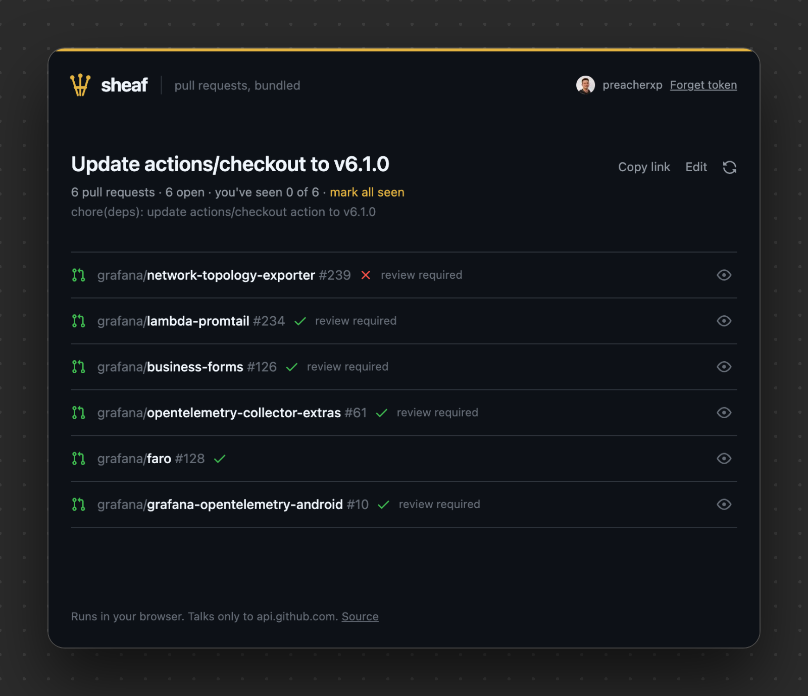
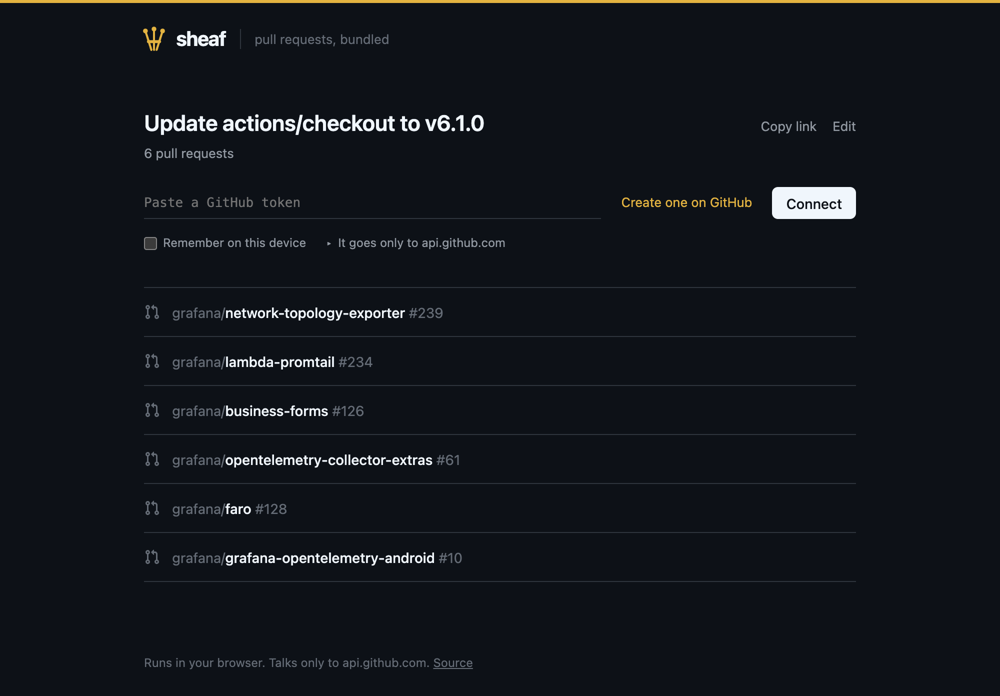
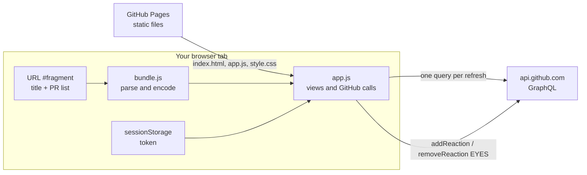

# sheaf

<p align="center"><a href="https://preacherxp.github.io/30-days-of-tools/"></a></p>

<p align="center"><a href="https://buymeacoffee.com/michal.hachula"></a></p>

A web page that turns the same pull request opened in many repositories into one link, showing each one's state, checks and review, and who has marked it 👀 seen.

You paste the pull requests of one change, say a dependency bump in eight services, and get a link at [preacherxp.github.io/sheaf](https://preacherxp.github.io/sheaf/). Whoever opens it connects with their own GitHub token and sees every pull request in one quiet list: open, draft, merged or closed, whether checks pass, whether review is still required. The eye button puts a 👀 reaction on the pull request from your account, so the next person can tell at a glance which ones somebody has already looked at. There is no server: the list lives in the link, and the page talks only to GitHub.

<p align="center"></p>

## Requirements

- A current Chrome, Edge, Firefox or Safari (Chrome 111, Firefox 113, Safari 16.2 or later)
- A GitHub token for each person who opens a link, which the page helps create in two clicks. A page can't use your github.com login: browsers don't send its cookies to other sites, and GitHub's API only takes tokens. GitHub's GraphQL API needs one even for public repositories:
  - fine-grained, with **Pull requests: Read and write** on the repositories (write is only used for 👀), or
  - classic, with the `repo` scope, or whatever `gh auth token` prints if you use the GitHub CLI
- [Node.js](https://nodejs.org) 20 or later to run the tests; nothing to build

## Install

Nothing to install. Open [preacherxp.github.io/sheaf](https://preacherxp.github.io/sheaf/).

To host it yourself, on your own origin, serve the folder over HTTP. ES modules don't load from `file://`.

```sh
git clone https://github.com/preacherxp/sheaf.git
cd sheaf
python3 -m http.server 8000   # then open http://localhost:8000
```

Any static host works the same way, GitHub Pages included. To uninstall, click **Forget token** on the page and revoke the token on GitHub under **Settings → Developer settings**.

## Usage

1. Open the page without a link. Give the bundle a title and paste its pull requests: full URLs, `owner/repo#123` or `owner/repo/123`, one per line, or any text that contains PR links, such as a Slack message or a Markdown checklist. Every PR link in a line counts. The counter under the box says how many it understood and which lines had none.
2. Click **Create link**, then **Copy link**, and send that link wherever you would have pasted eight.
3. Whoever opens it clicks **Create one on GitHub**. Because they are logged in, GitHub's token page opens with the `repo` scope and the name sheaf already filled in: pick an expiry, click **Generate token**, copy it. Pasting it into sheaf connects straight away. Tick **Remember on this device** to do this once.

<p align="center"></p>

- **Eye button.** At the end of each row. Click it to add your 👀 reaction to that pull request on GitHub, again to take it back. It turns gold while yours is on. Avatars of everyone who reacted 👀 sit next to it.
- **mark all seen.** Adds 👀 to every pull request in the bundle you haven't marked yet.
- **you've seen N of M.** Your own progress, in the line under the title. Avatars at the end of that line are the people who reacted 👀 on every one.
- **Titles.** The title most pull requests share is shown once, under the bundle title. A row only shows its own title when it differs.
- **Opened in this browser.** A repository name turns grey once you have visited that pull request, from your browser's own history.
- **Edit.** Back to the form with the list filled in. Saving gives a new link; the old one keeps showing the old list.
- **Refresh.** The circular arrow reloads everything. The page also reloads when you come back to its tab after 15 seconds or more, which is usually right after you looked at a pull request.

### What leaves your browser

- **The bundle** sits in the link after the `#`. Browsers never send that part to a server, so GitHub Pages only ever sees a request for `/sheaf/`.
- **Your token** goes to `api.github.com` and nowhere else. It is kept in this tab's `sessionStorage` and gone when the tab closes, unless you tick **Remember on this device**, which keeps it in `localStorage`.
- **Avatars** load from `avatars.githubusercontent.com`.
- The page's Content Security Policy allows exactly those two hosts and only its own scripts. There is no analytics, no font or script CDN, no backend. The page sends no `Referer`, and refuses to run inside a frame so another site can't trick a click on the eye button.

## Limits

- A 👀 reaction is a normal GitHub reaction: public on public repositories, visible to everyone who can see the pull request, and it says somebody looked, not that they approved.
- Everyone who opens a link needs a token, even for public repositories.
- A bundle shows its first 50 pull requests, and each row shows up to 5 avatars and counts the rest.
- The link is the bundle. Anyone you send it to sees which pull requests are in it, and it stays in browser history like any URL.
- On `preacherxp.github.io`, every page of that GitHub Pages site shares one origin, and so one `localStorage`. That's why **Remember on this device** is off by default. Host it on your own origin if you want to remember a token.
- A pull request you can't see shows as **Not found, or your token can't see this repository**. GitHub doesn't say which.

## Architecture



- **`index.html`** loads the page and sets the Content Security Policy that pins every request to `api.github.com` and avatars.
- **`bundle.js`** reads and writes the `#t=…&p=owner/repo/123,…` fragment. It accepts pull request URLs and the short forms, drops duplicates and anything that isn't a valid owner, repository and number, so nothing from the link reaches a query unchecked.
- **`app.js`** builds one GraphQL query per load with an alias for each pull request, passing names as variables, and renders the result with `textContent` only, so a pull request title can't inject markup. 👀 uses `addReaction` and `removeReaction`, then reloads.
- **`style.css`** uses GitHub's neutrals, status colours and type for light and dark mode, with a wheat gold of its own for the mark, the seen state and links.
- **`mark.svg`** is the mark: three pull requests, tied into one sheaf. `favicon.svg` is the same on a dark tile.
- The Octicons are inlined from [primer/octicons](https://github.com/primer/octicons) (MIT).

## Development

```sh
npm test                          # parser and link round trip tests, node --test
python3 -m http.server 8000       # serve the page; reload the browser after edits
SHEAF_TOKEN=$(gh auth token) PUPPETEER_CORE=/path/to/node_modules/puppeteer-core \
  node scripts/screenshot.mjs docs/sheaf.png '#t=…&p=…' dark 1000 640   # 2x screenshot of a real bundle
```

There is no build step and no dependencies. `scripts/screenshot.mjs` serves the folder itself, puts the token in the page's `sessionStorage` the way pasting it would, and uses an existing `puppeteer-core` and Chrome. `docs/hero.png` comes from the 30 days of tools thumbnail generator.

## License

[MIT](LICENSE)

<sub>If it saves you pasting the same eight links into chat again, you can [buy me a coffee](https://buymeacoffee.com/michal.hachula).</sub>
