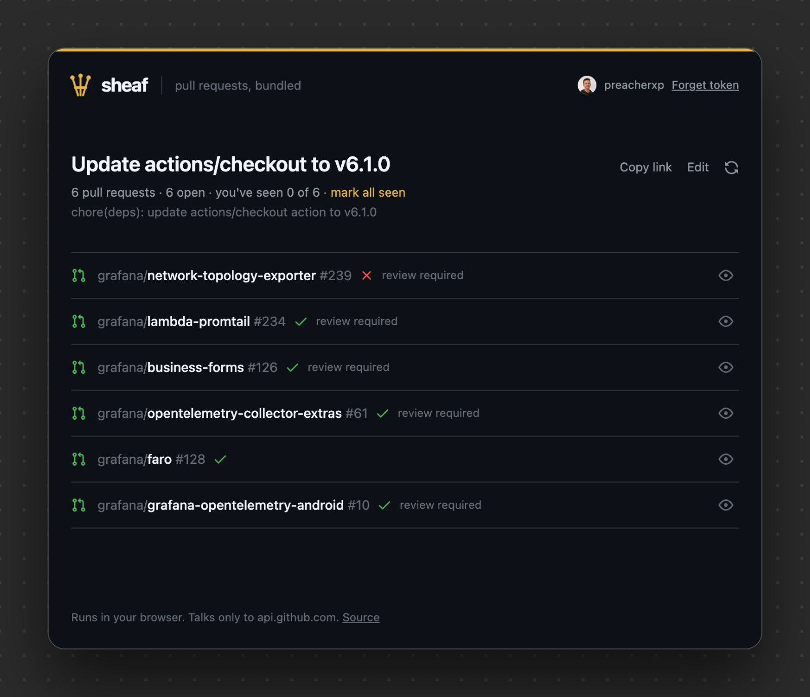
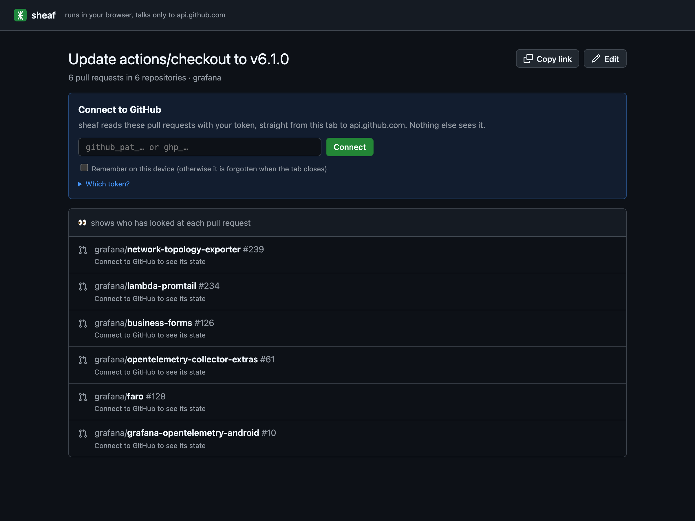
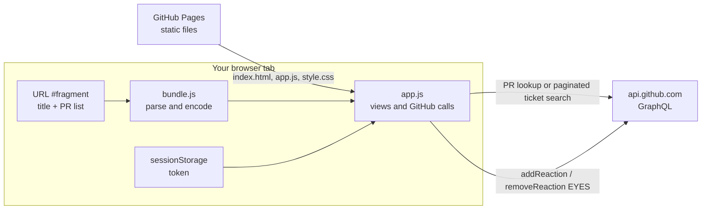

# sheaf

<p align="center"><a href="https://preacherxp.github.io/30-days-of-tools/"></a></p>

<p align="center"><a href="https://buymeacoffee.com/michal.hachula"></a></p>

A ticket key becomes a checklist of GitHub pull requests across repositories.

Put `CC-1234` in each PR title and run `npx . CC-1234` from this checkout. Sheaf opens one standalone HTML file with the matching PRs and a personal review checklist. For a live view you can share with teammates, use the [hosted app](https://preacherxp.github.io/sheaf/) instead.

<p align="center"></p>

## Requirements

- A current Chrome, Edge, Firefox or Safari (Chrome 111, Firefox 113, Safari 16.2 or later)
- A GitHub token to search by ticket or load live PR details; opening a saved HTML snapshot needs no token. For the hosted app:
  - fine-grained, with **Pull requests: Read and write** on the repositories (write is only used for 👀), or
  - classic, with the `repo` scope, or whatever `gh auth token` prints if you use the GitHub CLI
- [Node.js](https://nodejs.org) 20 or later for the CLI and tests. The glass effects use WebGPU when available; ordinary HTML provides the fallback.

## Install

Nothing to install. Open [preacherxp.github.io/sheaf](https://preacherxp.github.io/sheaf/).

Or generate a standalone HTML snapshot from the CLI:

```sh
git clone https://github.com/preacherxp/sheaf.git
cd sheaf
npx . CC-1234                                  # search PR titles and open .sheaf/CC-1234.html
npx . 'grafana/faro#128, grafana/loki#2'       # save explicit links to .sheaf/bundle.html
```

Include the key in each PR title (for example, `[CC-1234] Fix retry in worker`). The CLI uses `gh auth token` or `SHEAF_TOKEN` to find open, closed and merged PRs. It embeds the results and artwork in one file that opens offline, with no server or token inside. Rerun the command for fresh results. Anyone you send the file to can read the captured PR titles, including private ones.

To host it yourself, on your own origin, serve the folder over HTTP. ES modules don't load from `file://`.

```sh
python3 -m http.server 8000   # then open http://localhost:8000
```

Any static host works the same way, GitHub Pages included. To uninstall, click **Forget token** on the page and revoke the token on GitHub under **Settings → Developer settings**.

## Usage

### Review a saved snapshot

Open a PR from the list, then tick its checkbox when you’ve checked it. You can also use **Tab** and **Space**. The progress bar fills as you go; the last check shows **Review complete** and sends a ripple across the glass unless you prefer reduced motion.

Checkmarks stay in this browser when local storage is available. They don’t travel with the HTML file, approve a PR, or post a GitHub reaction. Rerun the CLI to pick up new PRs or updated states; refreshing the file only reopens the saved results.

### Share a live view

For a ticket-based view, share a link such as `https://preacherxp.github.io/sheaf/#ticket=CC-1234`. Each viewer connects with their own token and sees matching PRs they can access. For a hand-picked list:

1. Open the page without a link. Give the bundle a title and paste its pull requests: full URLs, `owner/repo#123` or `owner/repo/123`, one per line, or any text that contains PR links, such as a Slack message or a Markdown checklist. Every PR link in a line counts. The counter under the box says how many it understood and which lines had none.
2. Click **Create link**, then **Copy link**, and send that link wherever you would have pasted eight.
3. Whoever opens it clicks **Create one on GitHub**. Because they are logged in, GitHub's token page opens with the `repo` scope and the name sheaf already filled in: pick an expiry, click **Generate token**, copy it. Pasting it into sheaf connects straight away. Tick **Remember on this device** to do this once.

<p align="center"></p>

- **Eye button.** At the end of each row. Click it to add your 👀 reaction to that pull request on GitHub, again to take it back. It turns gold while yours is on. Avatars of everyone who reacted 👀 sit next to it.
- **mark all seen.** Adds 👀 to every pull request in the bundle you haven't marked yet.
- **you've seen N of M.** Your own progress, in the line under the title. Avatars at the end of that line are the people who reacted 👀 on every one.
- **Titles.** The title most pull requests share is shown once, under the bundle title. A row only shows its own title when it differs.
- **Opened in this browser.** A repository name turns grey once you have visited that pull request, from your browser's own history.
- **Edit.** Back to the form with the list filled in. Saving gives a new link; the old one keeps showing the old list.
- **Refresh.** The circular arrow reloads everything. The page also reloads when you come back to its tab after 15 seconds or more, which is usually right after you looked at a pull request.

### What leaves your browser

- **The bundle** sits in the link after the `#`. Browsers never send that part to a server, so GitHub Pages only ever sees a request for `/sheaf/`.
- **Your token** goes to `api.github.com` and nowhere else. The hosted app keeps it in the tab's `sessionStorage` unless you tick **Remember on this device**, which keeps it in `localStorage`. The CLI snapshot contains no token.
- **Avatars** load from `avatars.githubusercontent.com`.
- The page's Content Security Policy allows exactly those two hosts and only its own scripts. There is no analytics, no font or script CDN, no backend. The page sends no `Referer`, and refuses to run inside a frame so another site can't trick a click on the eye button.

## Limits

- A 👀 reaction is a normal GitHub reaction: public on public repositories, visible to everyone who can see the pull request, and it says somebody looked, not that they approved.
- Everyone loading live GitHub details needs a token, even for public repositories.
- The hosted app shows the first 50 PRs of a hand-picked list. Ticket searches in either mode paginate up to GitHub’s 1,000-candidate limit and match the exact key in the title, ignoring case.
- The link is the bundle. Anyone you send it to sees which pull requests are in it, and it stays in browser history like any URL.
- On `preacherxp.github.io`, every page of that GitHub Pages site shares one origin, and so one `localStorage`. That's why **Remember on this device** is off by default. Host it on your own origin if you want to remember a token.
- A pull request you can't see shows as **Not found, or your token can't see this repository**. GitHub doesn't say which.

## Architecture



- **`index.html`** loads the page and sets the Content Security Policy that pins every request to `api.github.com` and avatars.
- **`bundle.js`** reads and writes the `#t=…&p=owner/repo/123,…` fragment. It accepts pull request URLs and the short forms, drops duplicates and anything that isn't a valid owner, repository and number, so nothing from the link reaches a query unchecked.
- **`app.js`** builds one GraphQL query per load with an alias for each pull request, passing names as variables, and renders the result with `textContent` only, so a pull request title can't inject markup. 👀 uses `addReaction` and `removeReaction`, then reloads.
- **`style.css`** uses GitHub's neutrals, status colours and type for light and dark mode, with a wheat gold of its own for the mark, the seen state and links.
- **`cli.mjs`** writes snapshots to `.sheaf/`, opens the HTML file, and exits. The browser reads the saved file directly.
- **`mark.svg`** is the mark: three pull requests, tied into one sheaf. `favicon.svg` is the same on a dark tile.
- The Octicons are inlined from [primer/octicons](https://github.com/primer/octicons) (MIT).

## Development

The CLI embeds a vgpu renderer in each snapshot. The GPU draws the glass stack, reflections, contour field and text layer. Ordinary HTML provides keyboard navigation, print output and the fallback when WebGPU is unavailable. After `npm ci --prefix scripts/art`, run `npm run build:page --prefix scripts/art` to rebuild the renderer or `npm run render --prefix scripts/art` to regenerate the static artwork.

```sh
npm test                          # parser and link round trip tests, node --test
python3 -m http.server 8000       # serve the page; reload the browser after edits
SHEAF_TOKEN=$(gh auth token) PUPPETEER_CORE=/path/to/node_modules/puppeteer-core \
  node scripts/screenshot.mjs docs/sheaf.png '#t=…&p=…' dark 1000 640   # 2x screenshot of a real bundle
```

The renderer and fallback artwork are checked in, so using the CLI or hosted app requires no build. The dependencies in `scripts/art` are only for regenerating those assets. `scripts/screenshot.mjs` uses an existing `puppeteer-core` and Chrome to capture the hosted-style view.

## License

[MIT](LICENSE)

<sub>If it saves you pasting the same eight links into chat again, you can [buy me a coffee](https://buymeacoffee.com/michal.hachula).</sub>
